<div align="center">

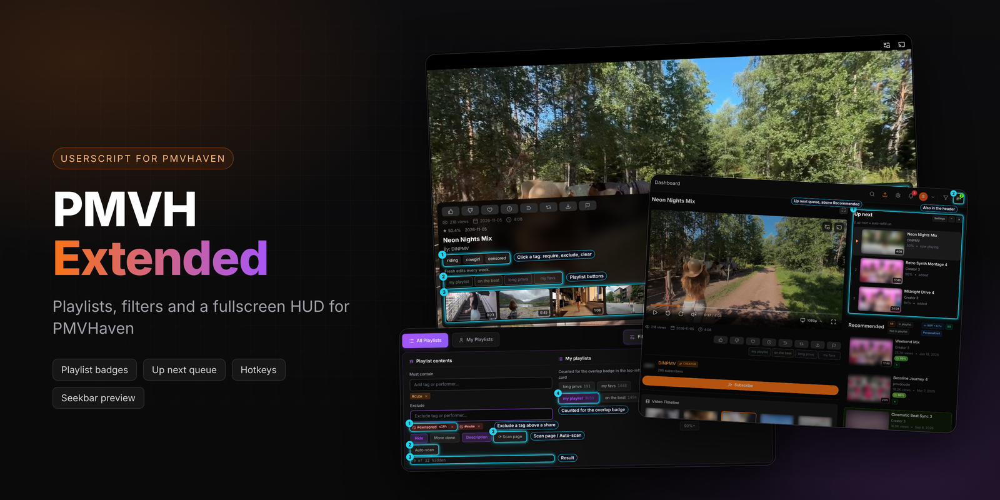

<br>

<a href="https://raw.githubusercontent.com/shooptydoopty-glitch/pmvh-extended/main/pmvh-extended.user.js"></a>
&nbsp;
<a href="#a-quick-tour"></a>

<sub>Works with Tampermonkey and Violentmonkey · MIT licensed · Unofficial, not affiliated with PMVHaven</sub>

</div>

<br>

**PMVH Extended** turns [PMVHaven](https://pmvhaven.com) into a proper playlist tool. See at a glance what you have already saved, add videos in one click, line up what plays next, and filter videos and playlists by their tags — all inside the site you already use, styled to fit right in.

<table>
<tr>
<td width="33%" valign="top"><b>Playlists everywhere</b><br>Badges on every card, one-click playlist buttons under the player, favourites and your playlists in the sidebar.</td>
<td width="33%" valign="top"><b>Fullscreen HUD</b><br>Title, tags, playlists and timeline at the bottom of the screen — without leaving fullscreen.</td>
<td width="33%" valign="top"><b>Up next queue</b><br>Your own queue next to Recommended, auto-refilled with videos that match your taste.</td>
</tr>
<tr>
<td valign="top"><b>Filter by tags</b><br>Hide videos and even whole playlists by tags, performers, rating, length or watch status — and see what was hidden, and why.</td>
<td valign="top"><b>Better playlist pages</b><br>Search tags and performers in the queue, sort it, and skip filtered videos while playing.</td>
<td valign="top"><b>Tags and models in one click</b><br>Vote on a video's tags and models, or add new ones, from a compact menu. Remappable hotkeys and <kbd>Ctrl</kbd>/<kbd>⌘</kbd>+<kbd>K</kbd> too.</td>
</tr>
</table>

## Install

1. Install a userscript manager: [Tampermonkey](https://www.tampermonkey.net/) or [Violentmonkey](https://violentmonkey.github.io/).
2. Open **[pmvh-extended.user.js](https://raw.githubusercontent.com/shooptydoopty-glitch/pmvh-extended/main/pmvh-extended.user.js)** — your userscript manager offers to install it.
3. Reload PMVHaven and log in. Your playlists load in the background on the first visit.

Updates arrive automatically through your userscript manager.

## A quick tour

### Your playlists, everywhere

Every video shows whether it is already in one of your playlists, and adding or removing it takes one click — under the player or on any card.

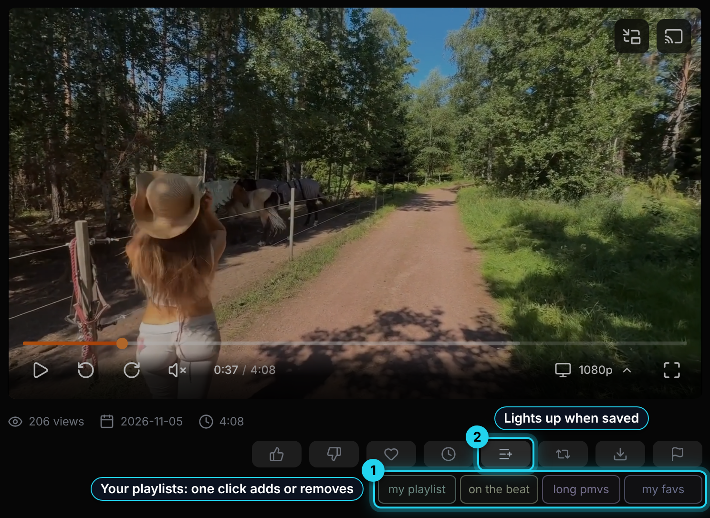
*① Reject, Tags and Models, right in the site's own button row. ② Your playlists: one click adds or removes the video. ③ The site's own Add to playlist button lights up when the video is saved.*

<table>
<tr>
<td width="50%" valign="top">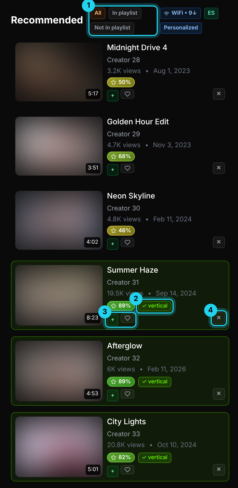<br><sub>① All / In playlist / Not in playlist. ② Playlist badge on saved videos. ③ Play next, add to a playlist, add to favourites. ④ Reject, in the corner of the thumbnail.</sub></td>
<td width="50%" valign="top">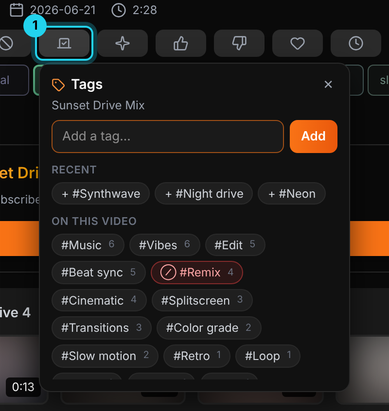<br><sub>① The tag menu: the video's tags with their votes (click to upvote, again to take it back), recent tags, and autocomplete for new ones. Tags your filter excludes show in red. The same menu exists for models.</sub><br><br>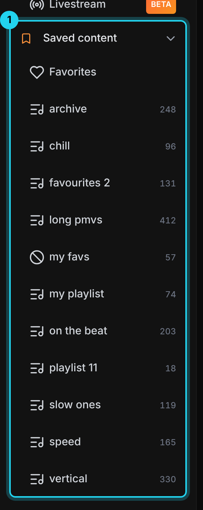<br><sub>① <i>Saved content</i> in the site's sidebar: your favourites and every playlist, with its size.</sub></td>
</tr>
</table>

<details>
<summary>More</summary>

- Badges on the home, browse, search and profile grids, *Recommended*, *More from* and notifications.
- **Favourites from any card**: the heart on a card adds or removes the video from your site favourites without opening it.
- **Reject list**: pick one playlist as your reject list. Adding a video there removes it from every other playlist; rejected videos show in red. Cards get a ⊘ in the corner of the thumbnail, and the player a ⊘ in its button row. While a filter is on, a card asks for a second click first.
- **Tag after reject**: after a reject, a small menu asks why — add a tag to the video on the site in a few keystrokes (can be turned off).
- **Tags and models**: the site's *Vote on Tags* opens the compact menu instead (<kbd>Shift</kbd>+click for the original); a second menu does the same for models.
- On playlist pages the button row also gets *open in a new tab* for the video that is playing.
- Saving, removing or rejecting never makes a card vanish under your cursor: filters pick the change up the next time you apply them.
- **Watch history**: a video counts as watched at 85 % or when it ends — usable in the filters.
- Playlists are cached locally and kept in sync across tabs; refresh any time with <kbd>R</kbd>.
- Players that come back empty after Back/Forward are repaired automatically.

</details>

### A HUD for fullscreen

Move the mouse to the bottom of the screen — or press <kbd>I</kbd> — and everything about the video is there: title, rating, tags and performers, your playlist buttons, the timeline and what plays next. Click a tag to require it in your filter, click again to exclude it.

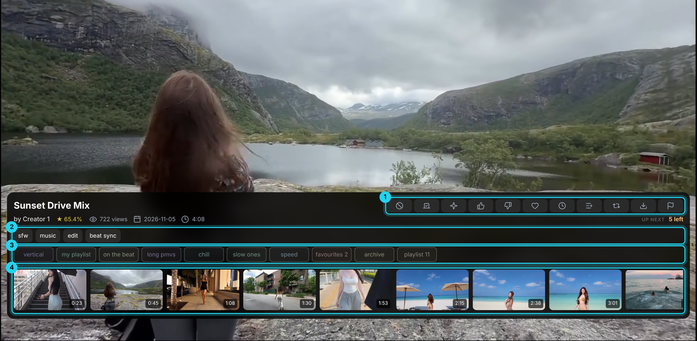
*① The button row, including reject, tags and models. ② Click a tag to require, exclude or clear it in the filter. ③ Playlist buttons. ④ Timeline thumbnails. With an Up next queue, how many videos are left sits on the right.*

A frame preview follows the mouse along the seek bar, in normal and fullscreen mode.

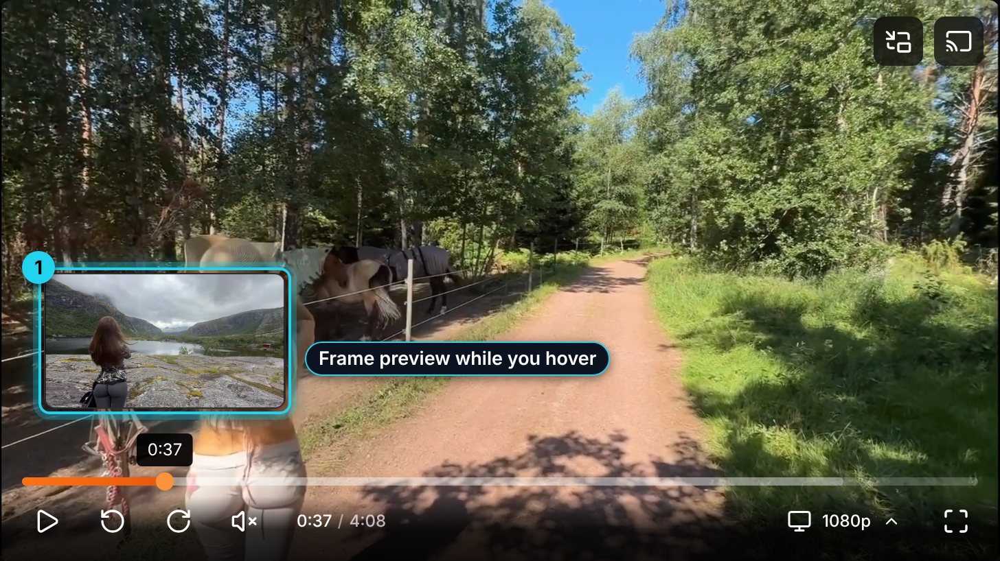
*① Frame preview while you hover the seek bar.*

<details>
<summary>More</summary>

- Up next keeps playing in fullscreen instead of dropping you back to the page.
- On playlist pages, move the mouse to the right edge to slide in the queue.
- The seekbar preview uses the site's timeline thumbnails; an optional live mode builds a denser frame cache in the background.

</details>

### Up next, your way

Line up videos from any card or with a hotkey. The queue lives next to *Recommended* and in the header, survives reloads, and <kbd>N</kbd> follows it.

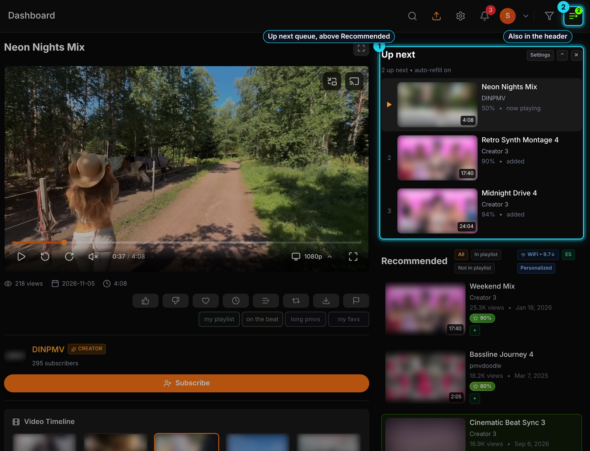

*① The Up next queue sits above Recommended; rows show your playlists, and why your filter would hide a video. ② Clear the videos you already played.*

<details>
<summary>More</summary>

- **Auto-refill** from Recommended, ranked by how well the tags match your own playlists, optionally through your filter.
- **Fill from your playlists** by count, minimum rating, maximum length, unwatched only and tag.
- Drag to reorder; played items stay as history (*Show more* for older ones), and the filter never removes anything from the queue.

</details>

### Filter what you see

One filter for the whole site, from the funnel in the header: exclude or require terms in titles, uploaders, tags and performers, hide or keep only videos with a content flag (nudity, gay, trans, extreme and more), and narrow by rating, length, watch status, playlists or one of your saved searches.

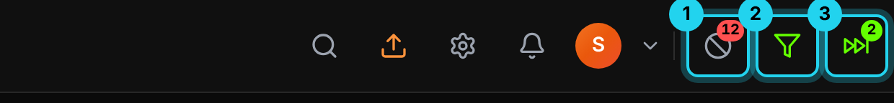

*① How many videos the filter hides on this page — click for the list. ② Site-wide video filter. ③ Up next, with the number of queued videos.*

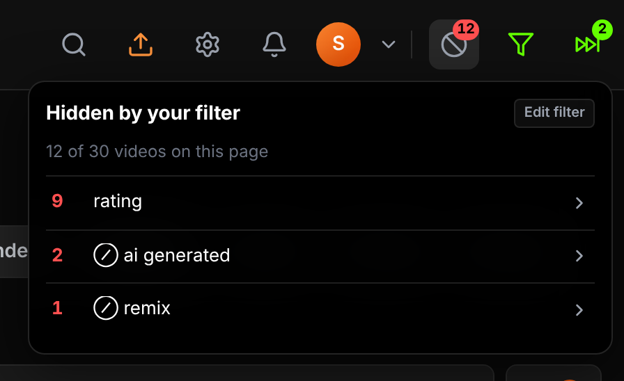

*Everything the filter hid on this page, grouped by reason; open a group to see the videos.*

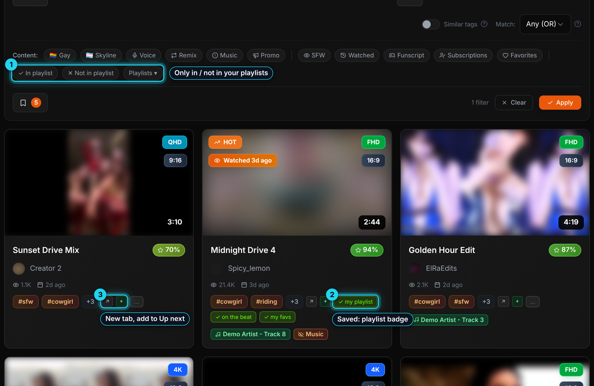
*① Right in the site's own filter menu: only videos in, or not in, your playlists — and which playlists count. It applies with the site's* Apply *and is stored with your saved filters. ② Playlist badge on saved videos. ③ Open in a new tab, play next, add to a playlist, add to favourites. ④ Reject.*

Your saved searches sit right next to *More Filters*, and on the homepage the site's filters, page and scroll position come back when you return with Back.

<details>
<summary>The filter panel</summary>

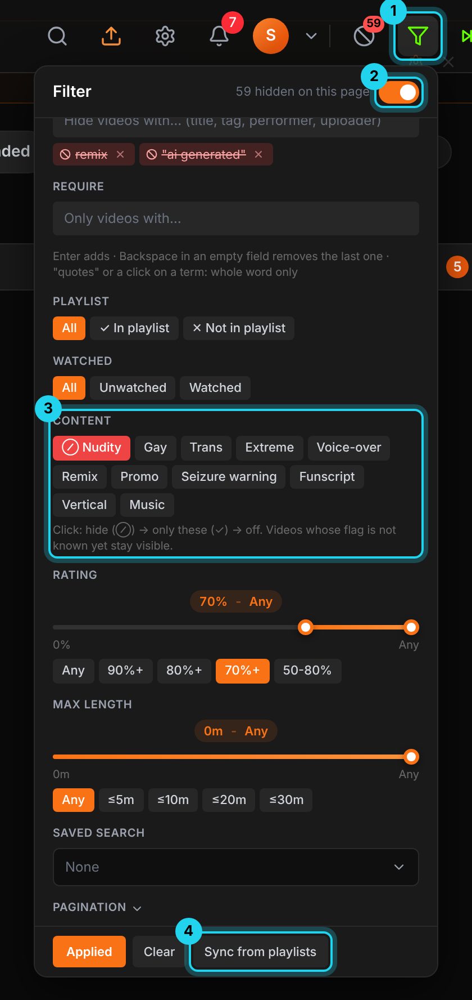
*① The funnel in the header opens the filter. ② On/off switch. ③ Content flags: click to hide, again for only these, again to clear. ④ Copy the filter from the playlist pages.*

- Terms, content flags, rating, length, playlists, watched status and one of your saved searches; an on/off switch keeps your settings.
- Content flags are the site's own (Nudity, Gay, Trans, Extreme, Voice-over, Remix, Promo, Seizure warning) plus Funscript, Vertical and Music. Flags a list does not include are looked up in batches of 100 and remembered; a video whose flag is still unknown is never hidden.
- Put a term in quotes, or click it, to match only the whole word: `"ch"` no longer hits *challenge*.
- In / not in playlist is ignored on a playlist's own page and on your favourites, where it would hide everything.
- Pagination helpers: larger pages, one continuous grid, paged mode while filtering, keep loading until enough results remain, skip near-empty pages.

</details>

### Playlist pages that keep up

The queue search finally looks at **tags, performers and descriptions**, not just titles. A filter drawer slides over the queue, playback skips whatever you filtered out, and the queue can be sorted by rating or upload date.

<table>
<tr>
<td width="50%" valign="top">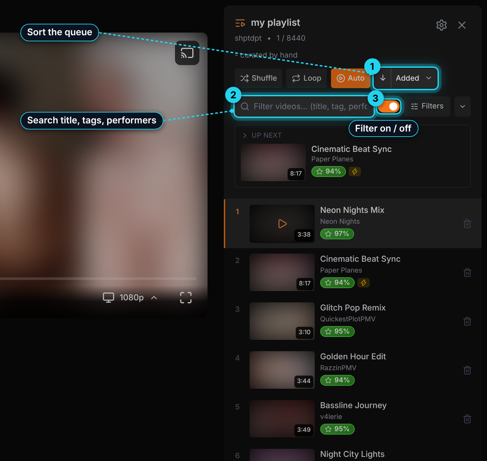<br><sub>① Sort the queue. ② Search titles, tags and performers. ③ Apply the filters; the badge counts the active ones.</sub></td>
<td width="50%" valign="top">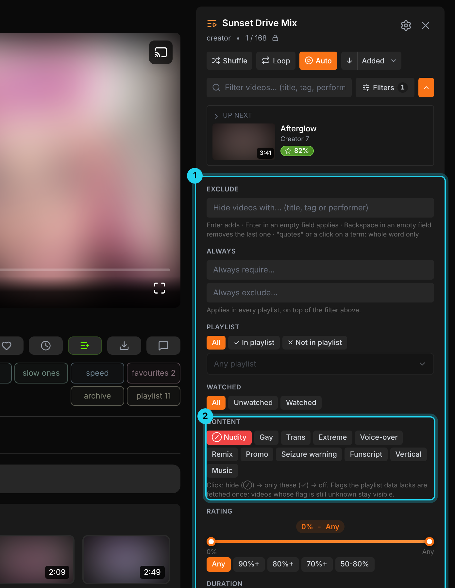<br><sub>① The filter drawer over the queue. ② Content flags, as in the site-wide filter. <i>Sync from site filter</i> copies the site-wide filter into it.</sub></td>
</tr>
</table>

<details>
<summary>More</summary>

- Drawer: excluded and required tags, default terms that apply in every playlist, in / not in playlist (the playlist you are viewing does not count), watched/unwatched, content flags, rating and duration sliders, saved search. Changes apply on <kbd>Enter</kbd> or *Filters*.
- Search syntax: `-term`, `"two words"`, `!in`, `!out`, `!in:name`, `!out:name`, `!seen`, `!unseen`.
- **Filter-aware playback**: next and auto-advance skip hidden videos, and the *Up Next* preview shows the real next video. <kbd>N</kbd> follows the sort order.
- *Fetch all* loads the complete playlist; deep links (`?index=N`) open at the right video even beyond the first page.

</details>

### Find playlists worth your time

On `/playlists`, filter playlists **by what is inside them**: hide a playlist when more than, say, 10 % of its videos carry a tag you don't like. Every card shows how many of its videos you already have — so *0 % overlap* means nothing but new videos.

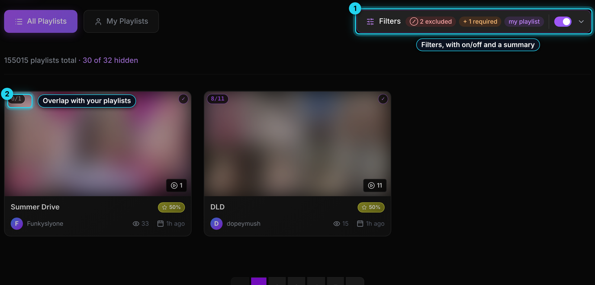
*① Filters button with on/off and a summary. ② Overlap with your own playlists on every card. ③ Follow a playlist straight from its card.*

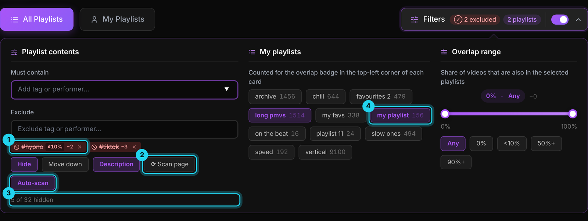
*① Exclude a tag above a share of the videos; the count shows how many playlists on the page it removes. ② Scan page / Auto-scan. ③ Result. ④ Your playlist counted for the overlap badge.*

<details>
<summary>More</summary>

- Hide filtered playlists or move them to the bottom; optionally match playlist descriptions too.
- Tag data is fetched **only when you press *Scan page*** — or automatically with *Auto-scan*. Playlists with more than 300 videos are sampled (first, last and a few pages in between, about 300 videos) so even huge playlists scan quickly; a ≈ on the card marks a sample, and clicking it scans that playlist in full.
- Results are cached and refreshed once a playlist's video count changes by more than 10 %.
- Every filter shows how many playlists it removes, so it is easy to see which one hides too much.

</details>

### Keyboard first

Every hotkey is remappable in a visual editor — bind a key to an action or straight to one of your playlists. The editor shows the defaults and the site's own shortcuts, so nothing gets overwritten by accident. <kbd>Ctrl</kbd>/<kbd>⌘</kbd>+<kbd>K</kbd> searches your playlists, cached videos and actions from anywhere.

<table>
<tr>
<td width="50%" valign="top">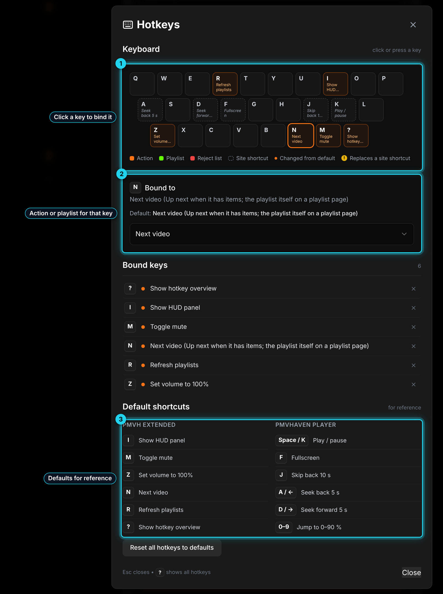<br><sub>① Click a key to bind it. ② The action or playlist for that key. ③ Defaults for reference.</sub></td>
<td width="50%" valign="top">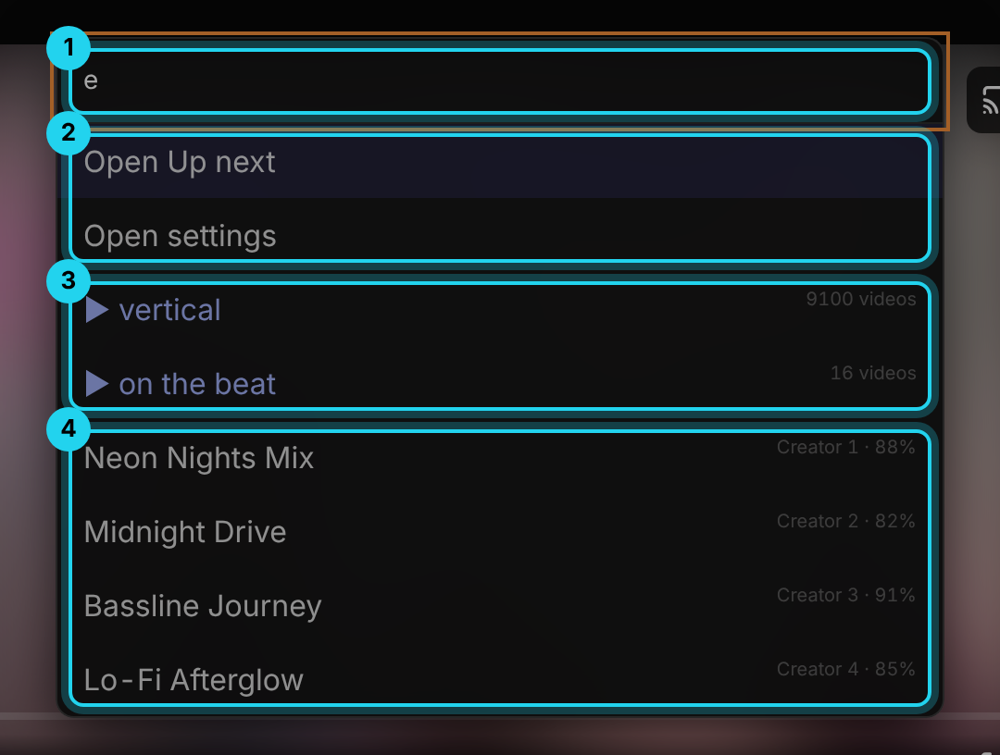<br><sub>① <kbd>Ctrl</kbd>/<kbd>⌘</kbd>+<kbd>K</kbd> anywhere. ② Actions. ③ Your playlists. ④ Cached videos.</sub><br><br>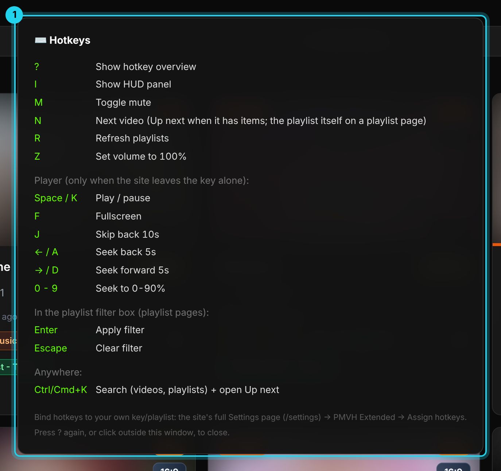<br><sub>① Press <kbd>?</kbd> for every hotkey.</sub></td>
</tr>
</table>

| Default key | Action |
|-----|--------|
| <kbd>I</kbd> | Show the HUD |
| <kbd>N</kbd> | Next video (Up next, or the playlist on playlist pages) |
| <kbd>M</kbd> | Toggle mute |
| <kbd>Z</kbd> | Volume to 100 % |
| <kbd>R</kbd> | Refresh playlists |
| <kbd>?</kbd> | Show all hotkeys |

Player keys (<kbd>Space</kbd>/<kbd>K</kbd>, <kbd>F</kbd>, <kbd>J</kbd>, arrows, <kbd>0</kbd>–<kbd>9</kbd>) keep working after in-site navigation and respect the site's *disable keyboard shortcuts* setting.

### Make it yours

Quick options live in a **PMVH Extended** section inside the site's own *Settings* dialog (the gear in the header); the bigger ones sit on the site's full **Settings** page.

<table>
<tr>
<td width="50%" valign="top">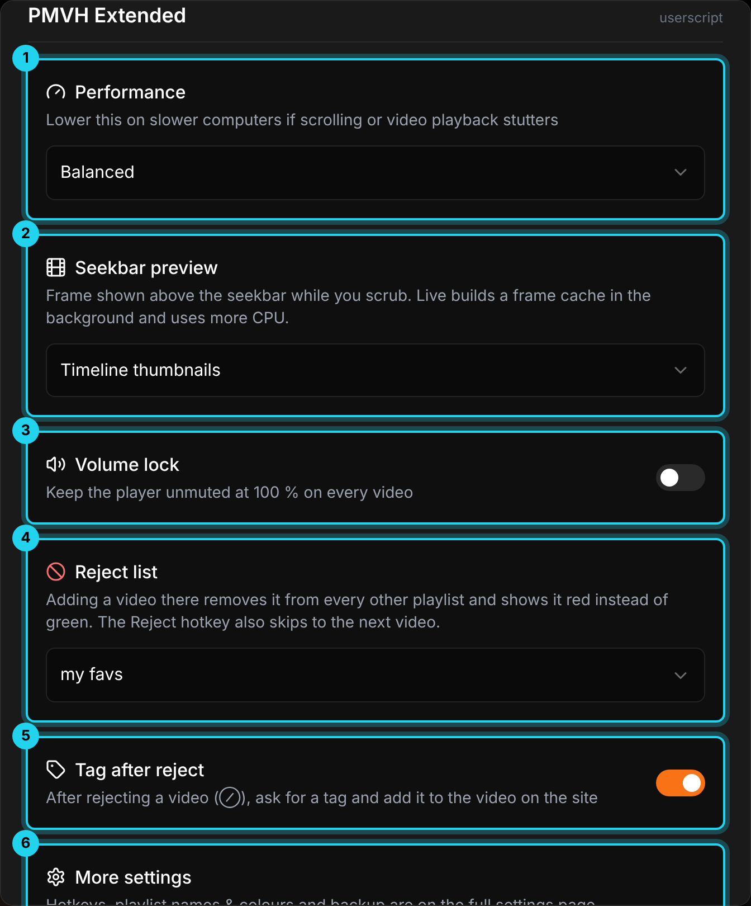<br><sub>① Performance mode. ② Seekbar preview source. ③ Volume lock. ④ Reject list. ⑤ Tag after reject. ⑥ A shortcut to the full settings page.</sub></td>
<td width="50%" valign="top">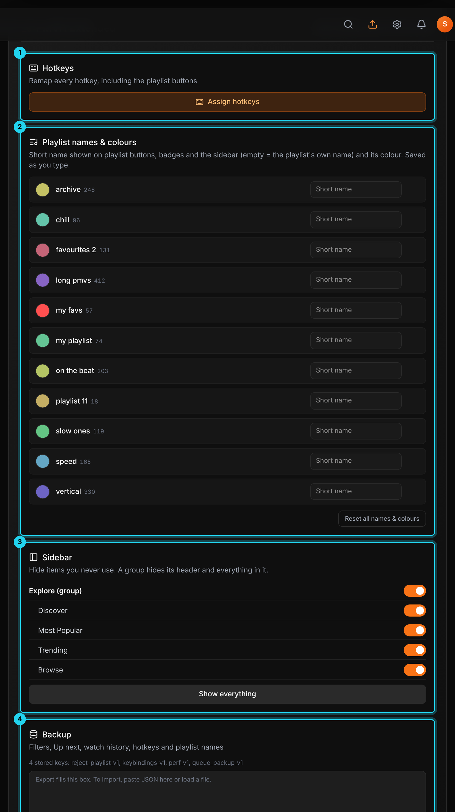<br><sub>① Hotkey editor. ② Short names and colours for your playlists. ③ Hide sidebar items you never use. ④ Settings backup.</sub></td>
</tr>
</table>

<details>
<summary>Performance modes</summary>

| Mode | Page updates | Visual effects | Background requests | Live seekbar preview |
|------|--------------|----------------|---------------------|----------------------|
| Smooth | every frame | on | 3 at a time | available |
| Balanced (default) | batched (≈8/s) | on | 3 at a time | available |
| Light | ≈2–3/s | off — also the site's blur and animations | 1 at a time | off |

</details>

- **Volume lock** keeps the player unmuted at 100 % (off by default).
- **Playlist names & colours**: give long playlist names a short label for the buttons, badges and sidebar, and pick their colour.
- **Sidebar**: hide any item or group of the site's sidebar.
- **Export / import** all settings as JSON — copy, download or load a file.

## Privacy and fair use

Everything runs in your browser. Settings, caches and watch history stay in `localStorage`; the script only talks to `pmvhaven.com`, with the session you are already logged in with. No accounts, servers or trackers.

PMVH Extended is built to be light on PMVHaven's servers: requests follow your own actions where possible, results are cached, duplicate requests are shared and rate limits (HTTP 429) are respected. Heavier background work — the live seekbar preview and automatic tag scanning on `/playlists` — is opt-in.

## Development

The userscript is built from `src/` with no dependencies:

```sh
node build.js   # writes pmvh-extended.user.js
```

| File | Contents |
|------|----------|
| `src/header.js` | Userscript metadata |
| `src/core.js` | Shared namespace, startup and performance helpers |
| `src/filter.js` | Playlist-page filter and the `/playlists` filter |
| `src/hud.js` | Playlist cache, badges, HUD, Up next, site-wide filter, settings, hotkeys, seekbar preview |
| `src/browse.js` | In / not-in-playlist filter in the site's filter menu, stored with saved filters |

Bug reports and pull requests are welcome. How the screenshots were made is described in [docs/screenshots](docs/screenshots/README.md).

## Disclaimer

PMVH Extended is an independent, unofficial project. It is not affiliated with, endorsed by or supported by PMVHaven; "PMVHaven" is a trademark of its owners. Use it at your own risk and respect the site's [terms](https://pmvhaven.com/terms).

## License

[MIT](LICENSE)
